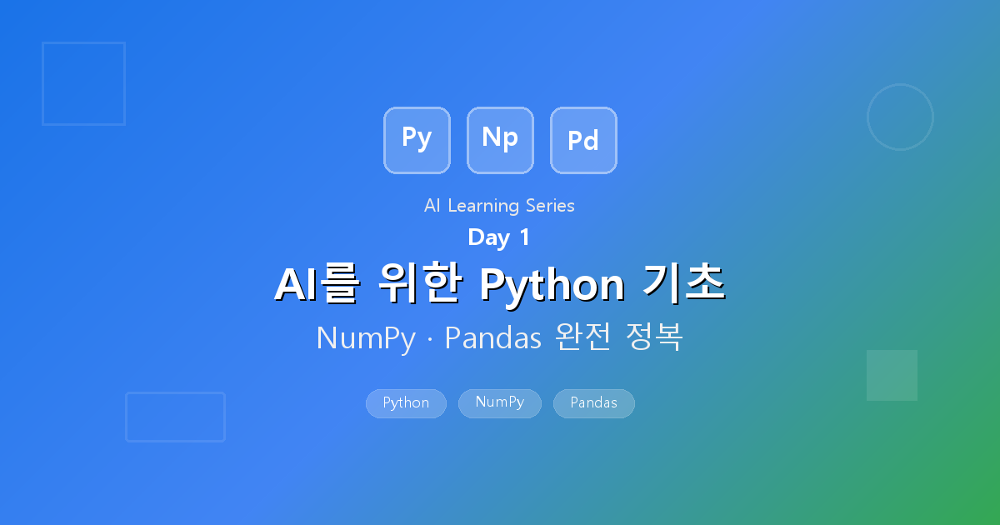
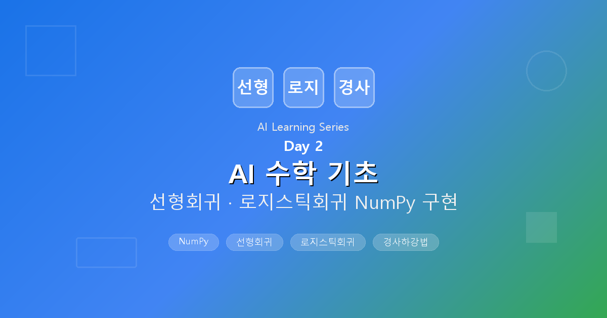

# AI 입문 강의 공부기록 — Claude Code로 블로그 자동화하기

> SSAFY AI 입문 강의 내용을 기반으로, **Claude Code**를 활용해 Velog 블로그 포스트와 썸네일을 자동 생성하는 프로젝트입니다.

---

## 프로젝트 개요

강의 노트북(`.ipynb`)을 입력으로 받아 다음을 자동 생성합니다:

- **블로그 포스트** — Velog 스타일 마크다운 (2,000~3,000자, SEO 최적화)
- **썸네일 이미지** — 1200×630px PNG (Python PIL로 생성)

Claude Code의 에이전트 팀(`blog-writer`, `source-analyst` 등)과 커스텀 스킬이 워크플로우를 자동으로 조율합니다.

---

## 디렉토리 구조

```
.
├── ai_lecture-master/        # 강의 원본 자료 (노트북 + 정리 자료)
│   ├── day1_Python_for_AI/
│   ├── day2_AI_Math/
│   ├── day3_AI_Data_EDA/
│   ├── day4_MLP/
│   ├── day5_CNN/
│   ├── day6_llm/
│   ├── day7_embeddings/
│   ├── day8_data_synthetic/
│   ├── day10_rag/
│   ├── day11_agent/
│   ├── day12_PEFT/
│   └── day14_Quantization/
├── _workspace/               # 자동 생성 산출물
│   ├── dayN_blog_post.md     # 블로그 포스트 초안
│   ├── dayN_gen_thumbnail.py # 썸네일 생성 스크립트
│   └── dayN_thumbnail.png    # 썸네일 이미지
└── .claude/                  # Claude Code 하네스 설정
    ├── CLAUDE.md             # 워크플로우 지침
    ├── agents/               # 전문 에이전트 정의
    └── skills/               # 오케스트레이터 스킬
```

---

## 강의 목록 & 블로그 진행 현황

| Day | 주제 | 핵심 키워드 | 글 상태 |
|-----|------|-------------|---------|
| 1 | Python 기초 + NumPy + Pandas | `python` `numpy` `pandas` | ✅ 완료 |
| 2 | 선형회귀 · 로지스틱회귀 (NumPy 구현) | `선형회귀` `경사하강법` `sigmoid` | ✅ 완료 |
| 3 | EDA + Scikit-learn 파이프라인 | `EDA` `scikit-learn` `PCA` | ⬜ 예정 |
| 4 | 신경망 + MLP (PyTorch) | `MLP` `pytorch` `autograd` | ⬜ 예정 |
| 5 | CNN + Fine-tuning | `CNN` `전이학습` `ViT` | ⬜ 예정 |
| 6 | 파운데이션 모델 → 멀티모달 · 디퓨전 | `LLM` `CLIP` `Stable Diffusion` | ⬜ 예정 |
| 7 | 토큰화 + 임베딩 + Transformer | `tokenizer` `embedding` `BERT` | ⬜ 예정 |
| 8 | LLM 데이터 생성 · 증강 | `합성데이터` `few-shot` `LLM as Judge` | ⬜ 예정 |
| 10 | LangChain + RAG | `RAG` `LangChain` `vector store` | ⬜ 예정 |
| 11 | Multi-turn + AI Agent + Gradio | `ReAct` `agent` `Gradio` | ⬜ 예정 |
| 12 | PEFT · LoRA · QLoRA | `LoRA` `QLoRA` `fine-tuning` | ⬜ 예정 |
| 14 | 모델 양자화 + llama.cpp | `quantization` `llama.cpp` `GGUF` | ⬜ 예정 |

---

## 썸네일 디자인

블루→그린 대각선 그라디언트 배경에 중앙 정렬 레이아웃을 사용합니다.

| Day 1 | Day 2 |
|-------|-------|
|  |  |

**공통 스펙**

| 항목 | 값 |
|------|----|
| 크기 | 1200 × 630 px |
| 배경 | `#1a73e8` → `#4285f4` → `#34a853` (135° 그라디언트) |
| 폰트 | Malgun Gothic |
| 레이아웃 | 아이콘 박스 → 시리즈 라벨 → Day번호 → 타이틀 → 서브타이틀 → 태그 |

---

## Claude Code 자동화 구조

```
.claude/
├── agents/
│   ├── blog-writer.md        — SEO 최적화 블로그 포스트 작성
│   ├── source-analyst.md     — 노트북 구조 분석 및 핵심 추출
│   ├── sns-copywriter.md     — SNS 포스트 변환
│   ├── presentation-builder.md — 슬라이드 구성
│   └── quality-reviewer.md  — 메시지 일관성 교차 검증
└── skills/
    ├── content-repurposer/   — 전체 파이프라인 오케스트레이터
    ├── platform-adaptation/  — 플랫폼별 콘텐츠 최적화
    └── content-atomization/  — 콘텐츠 원자화 및 재조합
```

새 day 글은 Claude Code에서 다음과 같이 요청합니다:

```
day3 블로그 글 작성해줘
```

---

## 주의사항

- `ai_lecture-master/day5_CNN/data/` — CIFAR-10 데이터셋은 용량 문제로 `.gitignore` 처리
- 노트북 내 API 토큰은 `YOUR_HF_TOKEN_HERE` 등 플레이스홀더로 대체됨
